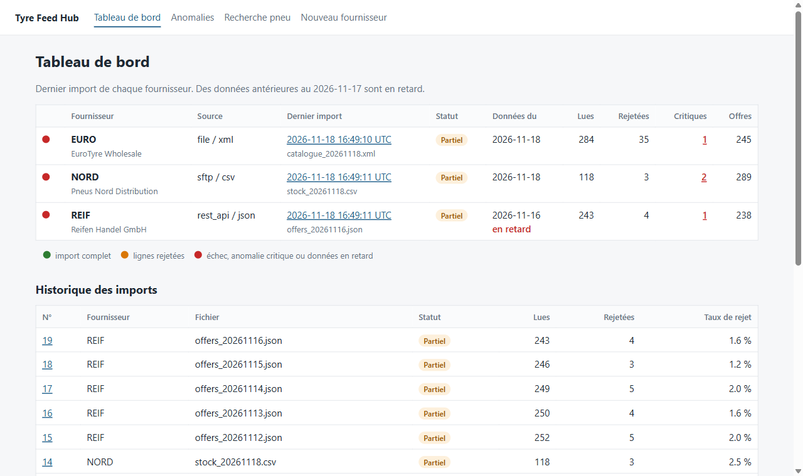
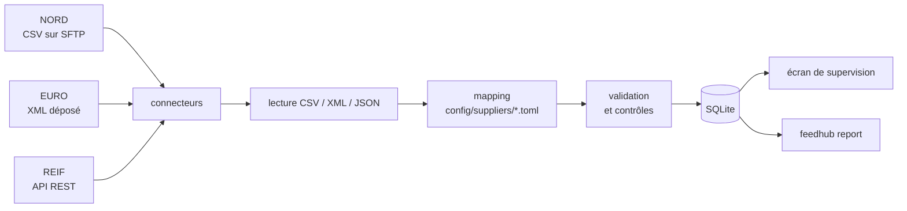
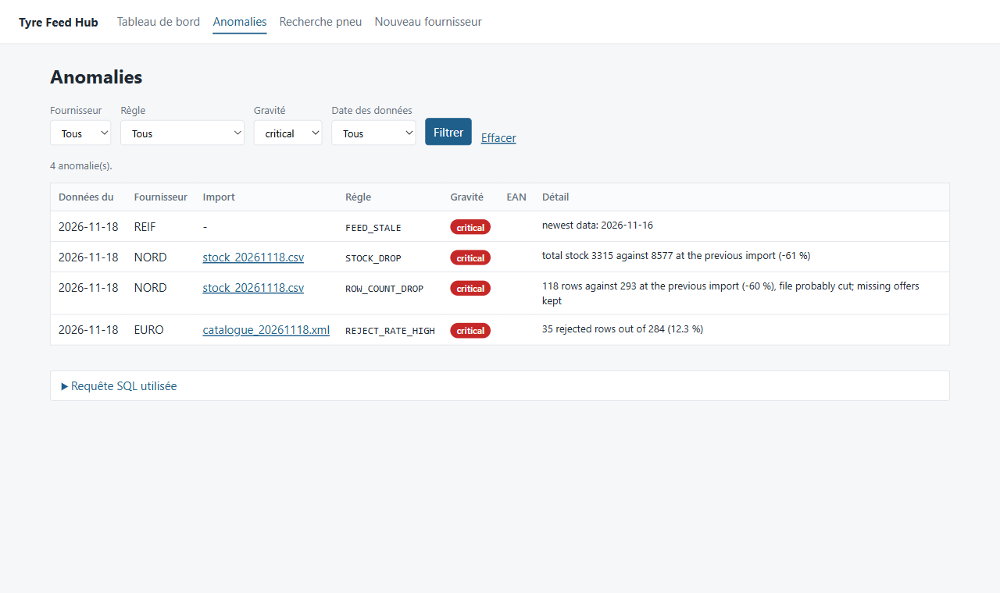
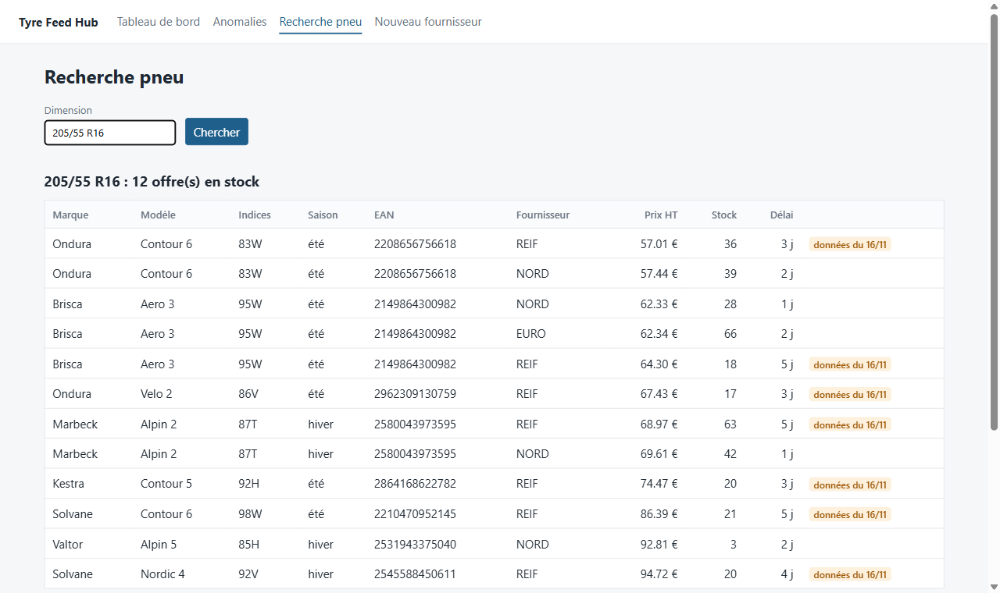
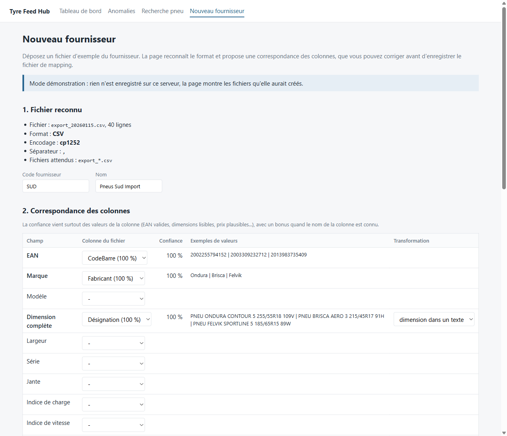

# Tyre Feed Hub

Un outil qui récupère les catalogues de plusieurs fournisseurs de pneus (CSV sur SFTP, XML déposé, API REST
JSON), les ramène dans une base SQL unique, détecte les anomalies et les affiche sur un écran de supervision.
Ajouter un fournisseur se fait en écrivant un fichier de mapping, avec une page qui le propose à partir d'un
fichier d'exemple. Tous les fournisseurs, produits et prix sont fictifs.

Démo en ligne : https://tyre-feed-hub.onrender.com (hébergement gratuit : la première page peut mettre
une minute à s'afficher si la démo était en veille).



## Démarrage

Avec Python 3.12 :

```
pip install -e .
feedhub init-db && feedhub generate --days 7 --inject-errors --scenario truncated-file --scenario price-crash --scenario dirty-file --scenario api-down && feedhub import --all
feedhub serve
```

Puis ouvrir http://127.0.0.1:8000.

Avec Docker : `docker build -t tyre-feed-hub . && docker run -p 8000:8000 tyre-feed-hub`. Le conteneur
fabrique lui-même une démo de 7 jours au démarrage.

Tests : `pip install -e ".[dev]"` puis `pytest`.

## Ce que fait le projet



- Trois fournisseurs fictifs avec chacun ses pièges : séparateur `;` et virgule décimale en latin-1, prix en
  centimes, champs en allemand, clé API, pagination, limite de débit (HTTP 429).
- Un générateur (`feedhub generate`) écrit leurs fichiers sur plusieurs jours, avec des erreurs injectées et
  des scénarios : fichier tronqué, prix effondrés, fichier sale, API en panne.
- Chaque ligne est validée (EAN-13, dimension, prix, stock) ; une ligne rejetée garde la ligne reçue pour
  le diagnostic.
- Des règles au niveau de l'import : taux de rejet, chute du nombre de lignes ou du stock, saut de prix,
  prix hors marché, fournisseur sans données récentes. Les seuils sont dans `config/thresholds.toml`.
- Un fichier tronqué ne fait pas disparaître les offres de la veille.
- Dix requêtes d'analyse dans `sql/queries/` (`feedhub report 1` à `10`), par exemple le meilleur prix par
  pneu ou les références disparues depuis l'import précédent.
- L'écran : tableau de bord, anomalies filtrables, détail d'un import, recherche par dimension, page
  « Nouveau fournisseur ». Chaque page montre la requête SQL qu'elle exécute.

| Anomalies | Recherche par dimension |
|---|---|
|  |  |

## Ajouter un fournisseur

La page « Nouveau fournisseur » lit un fichier d'exemple, reconnaît le format, l'encodage et le séparateur,
puis propose une correspondance des colonnes avec un pourcentage de confiance. Le calcul se fait surtout sur
les valeurs (EAN valides, dimensions lisibles, prix plausibles) et un peu sur le nom des colonnes. On corrige
si besoin, on voit le résultat d'un import à blanc, et on enregistre le fichier de mapping.

Le fichier `data/samples/sud/export_20260115.csv` sert d'exemple : ses colonnes s'appellent `CodeBarre`,
`PU_HT` ou `Qté`, et la dimension est cachée dans la désignation. Il s'intègre sans écrire de code.



Procédure complète, avec et sans la page : [docs/ajouter-un-fournisseur.md](docs/ajouter-un-fournisseur.md).

## Documentation

- [Architecture](docs/architecture.md) : le trajet d'un fichier, les tables, les choix.
- [Runbook](docs/runbook.md) : pour chaque anomalie critique, comment diagnostiquer et quoi faire.
- [Fiches fournisseurs](docs/fournisseurs/) : accès, format, colonnes, particularités.

## Choix techniques

J'ai choisi SQLite parce qu'il tient dans un fichier et ne demande aucune installation, tout en restant du
SQL standard : seuls les calculs de dates de quelques requêtes changeraient pour PostgreSQL. Le SQL est écrit
à la main, sans ORM, pour que chaque requête soit lisible et puisse être affichée sur l'écran.

Le code ne connaît aucun fournisseur : tout ce qui leur est propre est dans `config/suppliers/*.toml`. Un
nouveau fournisseur demande du code seulement s'il utilise un nouveau protocole.

Les pages sont rendues côté serveur avec FastAPI et Jinja2, avec un CSS écrit à la main, sans JavaScript.

Pour tester sans infrastructure, le SFTP et l'API se replient sur un dossier local quand leur adresse n'est
pas configurée. Une fausse API du fournisseur REIF (`mock_supplier_api/`) reproduit la clé, la pagination
et les refus 429 ; les tests la démarrent pour de vrai.

## Limites connues

- Le connecteur SFTP n'a pas été testé contre un vrai serveur : seulement avec un faux client dans les tests.
  Le `docker-compose.yml` fournit un serveur SFTP de test, pas encore utilisé. La clé d'hôte du
  serveur n'est pas vérifiée, ce qui n'est acceptable que pour ce serveur de test.
- Les exports de l'API sont tous téléchargés avant d'être importés : si le troisième échoue, les deux
  premiers ne sont pas importés non plus. Ils sont repris au lancement suivant.
- Le retard d'un fournisseur se mesure à la date écrite dans le nom de ses fichiers, au jour près.
- `feedhub import` ne tourne pas tout seul : en production, il faudrait le planifier (cron).
- L'écran n'a pas d'authentification.
- La page « Nouveau fournisseur » crée un fournisseur en « fichier déposé » ; un accès SFTP ou API se
  complète à la main dans le fichier de mapping. Elle lit les fichiers « à plat » seulement (pas d'attributs
  XML, pas d'objets JSON imbriqués).
- Les pneus renforcés (XL) et utilitaires (`C`) ne sont pas distingués dans la dimension.
- SQLite accepte un seul import qui écrit à la fois.
