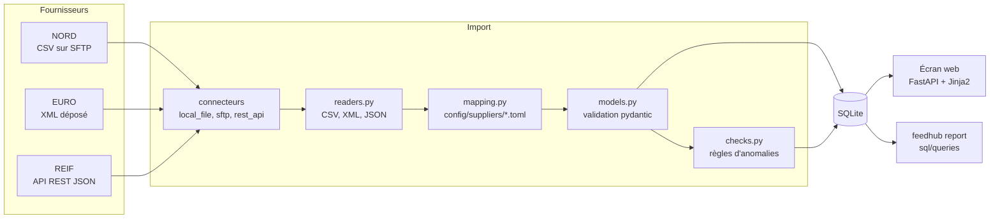

# Architecture

## Vue d'ensemble

## Le trajet d'un fichier

`pipeline.py` enchaîne les étapes, pour chaque nouveau fichier d'un fournisseur :

1. **Récupérer** : le connecteur du protocole renvoie `(nom du fichier, contenu brut)`. Les fichiers déjà
   importés avec succès sont sautés. Sans serveur configuré, SFTP et API lisent un dossier local.
2. **Lire** : `readers.py` transforme le contenu en liste de dictionnaires `{colonne: valeur}`.
3. **Traduire** : `mapping.py` renomme les colonnes et applique les transformations du `.toml`
   (virgule décimale, centimes, dimension, saison...).
4. **Valider** : `NormalizedOffer` (pydantic) vérifie chaque ligne : EAN, dimension plausible, prix,
   stock. Une ligne invalide est rejetée avec une anomalie qui garde la ligne reçue.
5. **Contrôler l'import** : taux de rejet, nombre de lignes et stock par rapport à l'import précédent,
   variations de prix.
6. **Charger** : produits, offres, photo des offres de cet import (`offer_snapshots`), anomalies, dans une
   seule transaction.

Après tous les fournisseurs : comparaison des prix entre fournisseurs (`PRICE_OUTLIER`) et recherche des
fournisseurs en retard (`FEED_STALE`).

## Les tables

| Table | Contenu |
|---|---|
| `suppliers` | un fournisseur par ligne (code, protocole, format) |
| `products` | un pneu par EAN : marque, dimension, indices, saison, label UE |
| `offers` | l'état actuel : prix, stock, délai d'un pneu chez un fournisseur |
| `import_runs` | chaque import : fichier, date des données, statut, compteurs, erreur |
| `offer_snapshots` | la photo des offres à chaque import, pour comparer d'un jour à l'autre |
| `anomalies` | règle, gravité, EAN éventuel et détail lisible |

Le schéma est dans `sql/schema.sql`. Un pneu proposé par trois fournisseurs a une ligne dans `products` et
trois dans `offers`.

## Où est quoi

| Dossier | Contenu |
|---|---|
| `config/suppliers/` | un fichier de mapping par fournisseur |
| `config/thresholds.toml` | seuils des règles d'anomalies |
| `sql/schema.sql` | les tables et index |
| `sql/queries/` | les 10 requêtes d'analyse (`feedhub report`) |
| `sql/pages/` | les requêtes des pages de l'écran |
| `src/feedhub/connectors/` | un module par protocole |
| `src/feedhub/web/` | l'écran : routes, gabarits HTML, CSS |
| `src/feedhub/generator.py` | les fichiers fictifs des 4 fournisseurs |
| `mock_supplier_api/` | la fausse API du fournisseur REIF |

## Choix techniques

- **SQLite** : un seul fichier, rien à installer, et du SQL standard. Le passage à PostgreSQL ne demande de
  changer que les calculs de dates de quelques requêtes.
- **SQL écrit à la main, sans ORM** : chaque requête est lisible telle quelle et l'écran peut l'afficher.
- **Un fichier de mapping par fournisseur** : ajouter un fournisseur ne demande pas de toucher au code.
- **pydantic** pour la validation : les règles d'une ligne valide sont au même endroit (`models.py`) et
  chaque erreur dit quel champ pose problème.
- **Pages HTML rendues côté serveur**, sans framework JavaScript ni CSS : simple à lire et à maintenir.
